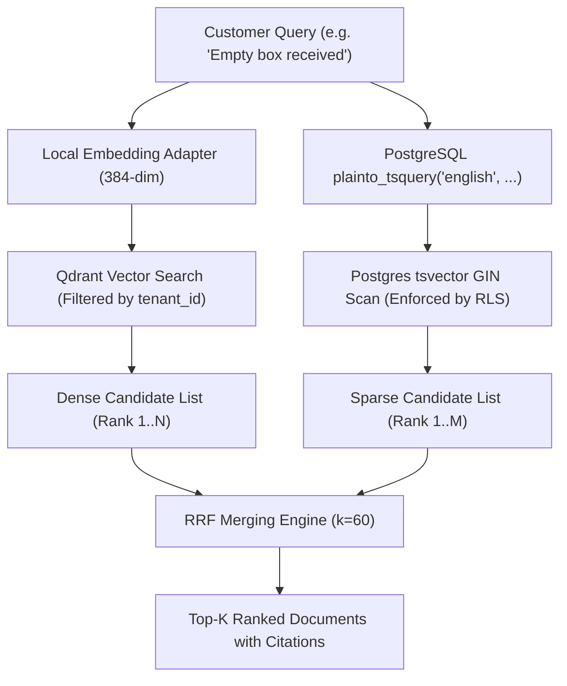

# Reverse Engineering: Hybrid RAG & Reciprocal Rank Fusion (RRF)

## 1. Why Hybrid Retrieval?
Single-mode retrieval models suffer from fundamental blind spots:
- **Dense Vector Search (Qdrant):** Excels at semantic intent, synonyms, and conceptual queries (e.g. "package arrived empty" matches "tampered shipment policy"). However, it struggles with exact part numbers, order IDs, error codes, and strict legal clauses.
- **Sparse Full-Text Search (PostgreSQL GIN tsvector):** Excels at precise keyword matching and alphanumeric codes, but fails completely when the customer uses phrasing not literally present in the document.

The platform fuses both using **Reciprocal Rank Fusion (RRF)**.

---

## 2. Mathematical Formulation: Reciprocal Rank Fusion

Given rank position $r_d(m)$ of document $d$ in retrieval method $m \in \{\text{dense}, \text{sparse}\}$:

$$\text{RRF\_Score}(d) = \sum_{m \in M} \frac{1}{k + r_d(m)}$$

Where $k$ is the smoothing constant (standard default $k = 60$).

### Advantages:
1. **Scale-Invariant:** Does not depend on the raw magnitude of Cosine similarity scores versus BM25/ts_rank values.
2. **Robust Ranking:** Documents that score moderately well in both methods receive a substantial boost over documents that score high in only one method with noisy similarity.

---

## 3. Retrieval Pipeline Architecture



### Strict Tenant Scoping in Retrieval:
1. **Qdrant Vector DB:** Every point payload contains `tenant_id`. Every vector query MUST include a must-match filter:
   ```json
   { "filter": { "must": [{ "key": "tenant_id", "match": { "value": "tenant-alpha" } }] } }
   ```
2. **PostgreSQL Full-Text Search:** Query is executed within an active database transaction where `SET LOCAL app.tenant_id = 'tenant-alpha'` is active. PostgreSQL kernel RLS guarantees that records belonging to other tenants are completely invisible to the GIN index scan.
