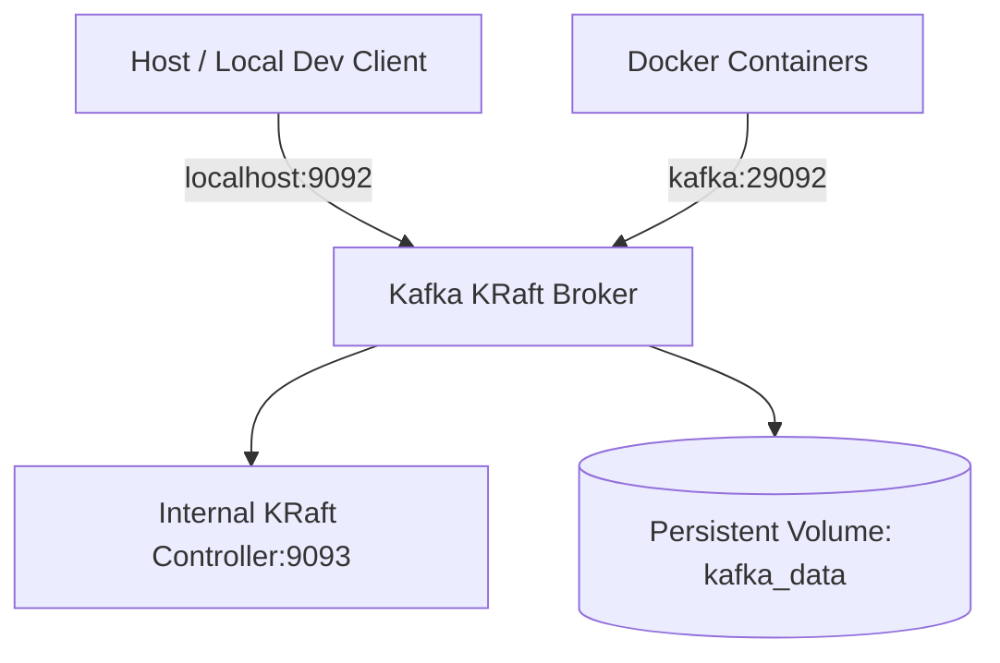

# Phase 1 Reverse-Engineering Guide: Monorepo & Core Infrastructure

> **Topic:** Monorepo Architecture, PostgreSQL Multi-Tenancy Foundation, Redis, Kafka KRaft, and Flyway  
> **Phase:** 1 (Project Foundation)  
> **Source Documents:** [`ENTERPRISE_AI_PLATFORM_BLUEPRINT.md`](../../ENTERPRISE_AI_PLATFORM_BLUEPRINT.md), [`AGENT.md`](../../AGENT.md)  

---

## 1. What Business & Technical Problem Does This Solve?

Modern enterprise AI platforms require an architecture where synchronous transactional operations (ticket creation, billing, audit) remain rock-solid and responsive even if asynchronous AI services (LLM inference, vector search, embeddings) experience latency spikes or downtime.

Phase 1 provides the local development foundation:
- Isolating services while keeping them in a single manageable monorepo.
- Running the complete persistence, caching, and messaging backbone locally at ₹0 cost.
- Preventing memory exhaustion on a 16 GB developer laptop.
- Establishing repeatable database migrations from day one.

---

## 2. Why Was This Architecture Chosen Over Alternatives?

| Decision Area | Chosen Solution | Rejected Alternatives | Architectural Rationale |
|---|---|---|---|
| **Repository Strategy** | Multi-service Monorepo | Polyrepo | Centralized contracts (`contracts/events`), unified CI, single Docker Compose, atomic cross-service changes without publishing private libraries. |
| **Event Broker** | Apache Kafka in KRaft Mode | RabbitMQ, Redis Streams, Kafka with ZooKeeper | ZooKeeper adds 500 MB+ RAM overhead and operational complexity. KRaft embeds quorum controllers directly inside Kafka brokers. Kafka enables event replay, per-tenant partition ordering, and independent consumer groups. |
| **Database Ownership** | Single PostgreSQL instance with distinct per-service logical databases | Shared schema across services, or separate Postgres Docker containers per service | 7 separate Postgres containers would consume 2.5 GB+ RAM. A single Postgres instance with separate databases (`ticket_db`, `identity_db`, etc.) enforces service encapsulation with < 500 MB RAM usage. |
| **Cache & KV** | Redis 7 Alpine with memory cap | Memcached, In-memory JVM cache | Redis supports persistent writes (AOF), atomic operations, TTL expiration, and namespaced caching (`t:{tenant_id}:...`) shared between Java and Python. |
| **Schema Migrations** | Flyway (versioned SQL migrations) | Hibernate `hbm2ddl.auto=update`, Liquibase | Raw SQL migrations are transparent, deterministic, version-controlled, and database-native. |

---

## 3. How Does the Implementation Work Internally?

### 3.1 Docker Compose Profile Isolation
Docker Compose profiles allow starting only the infrastructure needed for the current task:
```text
docker-compose --profile core up -d
```
- `core`: PostgreSQL 16, Redis 7, Kafka KRaft (Total footprint: ~1.75 GB RAM).
- `obs`: OpenTelemetry Collector (Total footprint: ~250 MB RAM).
- `tools`: Flyway migration runner.
- `ai`: Python FastAPI, Ollama, Qdrant (Phase 5+).

### 3.2 Kafka KRaft Architecture
In KRaft (Kafka Raft Metadata Mode), the broker uses an internal Raft quorum instead of an external ZooKeeper cluster:
- `KAFKA_PROCESS_ROLES: 'broker,controller'` allows a single container to act as both controller and broker.
- Dual listeners (`INTERNAL://0.0.0.0:29092` for docker containers and `EXTERNAL://0.0.0.0:9092` for host access) prevent network translation issues.



### 3.3 PostgreSQL Multi-Database Initialization
When `postgres` container starts for the first time with an empty volume:
1. Entrypoint executes `/docker-entrypoint-initdb.d/01-init-databases.sh`.
2. Creates non-superuser role `app_user` with password `app_dev_password`.
3. Creates 7 logical databases:
   - `identity_db` (Tenants, memberships, roles)
   - `ticket_db` (Tickets, comments, SLA, outbox)
   - `knowledge_db` (Documents, chunks metadata)
   - `workflow_db` (Sagas, state machines)
   - `notification_db` (Webhooks, notifications)
   - `usage_db` (Auditing, metering)
   - `ai_db` (LangGraph checkpoints, evaluation runs)
4. Grants full privileges to `app_user` and `postgres`.

---

## 4. Key Design Patterns Applied

- **Database-per-Service:** Each microservice connects exclusively to its own database. Cross-database queries and foreign keys across services are strictly prohibited.
- **Principle of Least Privilege:** Application connections will use non-superuser `app_user` so that PostgreSQL Row-Level Security (RLS) cannot be bypassed.
- **Ephemeral Tooling (Run-and-Done):** Flyway runs inside a lightweight ephemeral container, applies pending migrations, and exits immediately without keeping memory allocated.

---

## 5. Security & Multi-Tenancy Considerations

- **No Hardcoded Secrets:** All credentials in `docker-compose.yml` use environment variables with fallback defaults suited only for local development.
- **Tenant-Scoped Redis Keys:** Keys must adhere to `t:{tenant_id}:{subsystem}:{key}`.
- **Memory Caps (Denial-of-Service Defense):** Container memory limits prevent runaway processes or memory leaks from freezing the host operating system.

---

## 6. Important Files & Configurations to Inspect First

| File | Purpose |
|---|---|
| [`docker-compose.yml`](file:///d:/Capstone%20projects/ticket%20resolving%20system/docker-compose.yml) | Service definitions, networking, profiles, health checks, and memory limits |
| [`.env.example`](file:///d:/Capstone%20projects/ticket%20resolving%20system/.env.example) | Complete list of configuration variables and ports |
| [`infra/docker/postgres/01-init-databases.sh`](file:///d:/Capstone%20projects/ticket%20resolving%20system/infra/docker/postgres/01-init-databases.sh) | Automated multi-database and application role provisioning |
| [`backend/ticket-service/src/main/resources/db/migration/V1__baseline_infrastructure.sql`](file:///d:/Capstone%20projects/ticket%20resolving%20system/backend/ticket-service/src/main/resources/db/migration/V1__baseline_infrastructure.sql) | Baseline infrastructure verification table |
| [`scripts/test-connectivity.ps1`](file:///d:/Capstone%20projects/ticket%20resolving%20system/scripts/test-connectivity.ps1) | Automated end-to-end connectivity verification suite |

---

## 7. How to Reproduce and Debug Locally

1. **Launch Core Stack:**
   ```powershell
   .\scripts\dev.ps1 up-core
   ```
2. **Execute Full Automated Verification:**
   ```powershell
   .\scripts\dev.ps1 test-infra
   ```
3. **Execute Migrations:**
   ```powershell
   .\scripts\dev.ps1 migrate
   ```
4. **Inspect Live Metrics:**
   ```powershell
   .\scripts\dev.ps1 status
   ```

