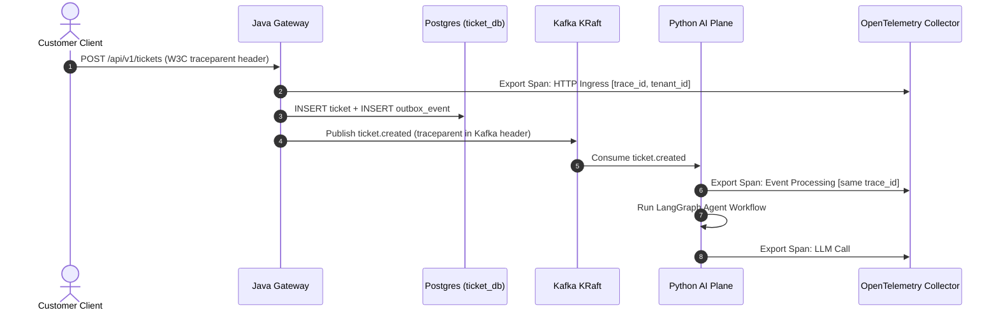

# Phase 1 Reverse-Engineering Guide: Observability & Logging Foundation

> **Topic:** OpenTelemetry Collector Architecture, Structured JSON Logging, and W3C Trace Context Propagation  
> **Phase:** 1 (Project Foundation)  
> **Source Documents:** [`ENTERPRISE_AI_PLATFORM_BLUEPRINT.md`](../../ENTERPRISE_AI_PLATFORM_BLUEPRINT.md) (Section 14)  

---

## 1. What Business & Technical Problem Does This Solve?

In a distributed, event-driven AI platform spanning Java backend services, Kafka event queues, and Python AI agents, tracking down failures without correlation IDs is nearly impossible.

When a customer submits a ticket:
1. It hits the Java API Gateway.
2. The Gateway creates a ticket in `ticket_db` and writes an outbox event.
3. Kafka transports the event.
4. Python AI consumers pick up the event, invoke LLM and RAG pipelines, and publish response events.

Without end-to-end tracing, identifying whether a delay occurred in the database transaction, Kafka broker lag, or LLM token generation is guesswork. Phase 1 establishes the unified observability foundation so that **every log line and metric is correlated to a single trace from day one**.

---

## 2. Architecture & Internal Data Flow

---

## 3. Log Format Standard (Structured JSON)

Both the Java Spring Boot control plane and Python AI plane format logs as structured JSON to stdout. This enables log shippers (Promtail/Loki) to ingest logs without custom regex parsers.

### Standard JSON Log Fields

| Field Name | Type | Description | Example |
|---|---|---|---|
| `timestamp` | String (ISO-8601 UTC) | Time of event emission | `"2026-11-07T08:15:30.123Z"` |
| `service` | String | Microservice name | `"ticket-service"` |
| `level` | String | Log level | `"INFO"`, `"ERROR"`, `"WARN"` |
| `trace_id` | String | 32-character hex OpenTelemetry trace ID | `"4bf92f3577b34da6a3ce929d0e0e4736"` |
| `span_id` | String | 16-character hex OpenTelemetry span ID | `"00f067aa0ba902b7"` |
| `tenant_id` | String | Authenticated tenant identifier (from JWT) | `"tenant-acme-corp"` |
| `ticket_id` | String | Domain entity ID (if applicable) | `"tkt-8942"` |
| `correlation_id` | String | Client or request correlation identifier | `"req-abc-123"` |
| `message` | String | Human-readable log summary | `"Ticket created successfully"` |

---

## 4. Implementation Details

### Java Spring Boot (Logback Spring Configuration)
- Located at [`backend/common/src/main/resources/logback-spring.xml`](file:///d:/Capstone%20projects/ticket%20resolving%20system/backend/common/src/main/resources/logback-spring.xml).
- Uses `net.logstash.logback.encoder.LoggingEventCompositeJsonEncoder`.
- Extracts MDC variables: `MDC.put("tenant_id", tenantId)`.
- Automatically inherits Micrometer / OpenTelemetry trace and span IDs.

### Python AI Plane (Structlog Configuration)
- Located at [`ai-plane/app/observability/logging_config.py`](file:///d:/Capstone%20projects/ticket%20resolving%20system/ai-plane/app/observability/logging_config.py).
- Uses `structlog` with custom processor `add_opentelemetry_context`.
- Extracts active span via `opentelemetry.trace.get_current_span()`.
- Emits newline-delimited JSON.

### OpenTelemetry Collector
- Located at [`infra/observability/otel-collector-config.yaml`](file:///d:/Capstone%20projects/ticket%20resolving%20system/infra/observability/otel-collector-config.yaml).
- Listens on `0.0.0.0:4317` (gRPC) and `0.0.0.0:4318` (HTTP).
- Employs `memory_limiter` and `batch` processors to prevent memory spikes on a 16 GB laptop.

---

## 5. Security & PII Redaction Rules

- **Zero Secret Leaking:** Passwords, API tokens, Authorization headers, and encryption keys must never be logged.
- **Tenant Context Sanitization:** `tenant_id` is derived from verified JWT claims, not unvalidated client parameters.
- **PII Scrubbing:** Customer email addresses, phone numbers, and payment details must be masked before emission.

