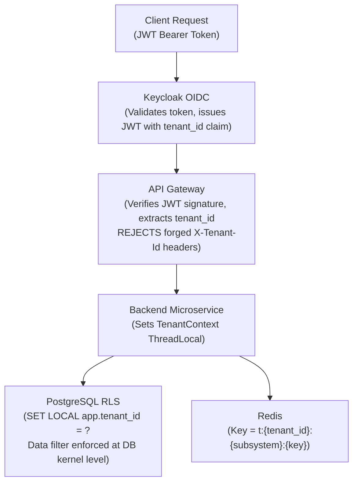

# Phase 2 Reverse-Engineering Guide: Multi-Tenancy, Authentication & Row-Level Security

> **Phase:** 2 — Identity, Authentication & Multi-Tenancy  
> **Source:** [`ENTERPRISE_AI_PLATFORM_BLUEPRINT.md`](../../ENTERPRISE_AI_PLATFORM_BLUEPRINT.md) (Sections 8.2, 13)  
> **Status:** Verified & Tested Live

---

## 1. What Business Problem Does This Solve?

The platform serves multiple isolated organizations (**tenants**) on shared infrastructure. Without strict enforcement:
- Tenant A's support agents could accidentally read Tenant B's customer data.
- A malicious user could forge a request header to impersonate another tenant.
- A database connection pooled from a previous request could "carry over" one tenant's context into another's transaction.

**Phase 2 makes all three attack vectors technically impossible**, not just policy-forbidden.

---

## 2. The Four Layers of Tenant Isolation



| Layer | Mechanism | Location |
|---|---|---|
| **Layer 1: Identity Source** | Keycloak validates credentials, issues JWT with `tenant_id` claim | `infra/keycloak/realm-export.json` |
| **Layer 2: API Gateway** | Verifies JWT signature + extracts `tenant_id` from token claims only | `backend/gateway/` (Phase 2+) |
| **Layer 3: Thread Context** | `TenantContext.setTenantId()` populates ThreadLocal per request | `backend/common/src/main/java/.../context/TenantContext.java` |
| **Layer 4: Database RLS** | `SET LOCAL app.tenant_id = ?` enforced by Postgres kernel per transaction | `backend/identity-tenant-service/.../V1__identity_and_tenant_rls.sql` |

---

## 3. How Keycloak Token Issuance Works

### 3.1 Realm Configuration
The realm `enterprise-ai` is imported declaratively at Keycloak startup from [`infra/keycloak/realm-export.json`](../../infra/keycloak/realm-export.json).

**Key configuration decisions:**
- `KC_DB=postgres` — Keycloak stores its own sessions and user data in `keycloak_db` within the shared Postgres instance.
- `--import-realm` flag — Ensures the realm, users, and protocol mappers are automatically imported on first boot.
- `start-dev` mode — Appropriate for local development; disables HTTPS enforcement.

### 3.2 JWT `tenant_id` Claim Mapping
The realm export defines a **protocol mapper** of type `oidc-usermodel-attribute-mapper`:
```json
{
  "name": "tenant_id-mapper",
  "protocolMapper": "oidc-usermodel-attribute-mapper",
  "config": {
    "user.attribute": "tenant_id",
    "claim.name": "tenant_id",
    "access.token.claim": "true"
  }
}
```
When Alice (`alice@alpha.com`) logs in, Keycloak reads her user attribute `tenant_id = "tenant-alpha"` and injects it directly into the JWT access token payload. **The client never supplies the tenant ID — the identity provider owns it.**

### 3.3 Actual Decoded JWT (Live Test Evidence)
```json
{
  "sub": "ab2cd63b-1a28-44ae-9b46-2cd3c789558f",
  "tenant_id": "tenant-alpha",
  "realm_access": {"roles": ["TENANT_ADMIN"]},
  ...
}
```

---

## 4. How PostgreSQL Row-Level Security Works

### 4.1 Policy Definition
```sql
CREATE POLICY tenant_isolation_user_memberships ON user_memberships
    AS PERMISSIVE FOR ALL TO app_user
    USING (tenant_id = NULLIF(current_setting('app.tenant_id', true), ''))
    WITH CHECK (tenant_id = NULLIF(current_setting('app.tenant_id', true), ''));
```

- `NULLIF(..., '')` safely handles the case where `app.tenant_id` is not set — returns `NULL`.
- A `NULL = NULL` comparison is always `FALSE` in SQL, so **zero rows are visible if the application code forgets to call `SET LOCAL`** — an automatic deny-by-default.
- `WITH CHECK` prevents inserting rows for a different tenant than the active session.

### 4.2 SET LOCAL — Why It Prevents Pool Leakage
```sql
-- Application code at transaction start:
SET LOCAL app.tenant_id = 'tenant-alpha';
```
`SET LOCAL` applies **only to the current transaction**. When the transaction commits or rolls back, Postgres automatically reverts the variable to its prior value (empty). The connection is then returned to HikariCP's pool **clean**, with no tenant context remaining.

This was verified live:
```text
Transaction 1: SET LOCAL app.tenant_id = 'tenant-alpha'; COMMIT;
Transaction 2 (same session): current_setting('app.tenant_id') → '' (empty)
Result: [OK] Session setting reset confirmed: No tenant leakage across transactions.
```

### 4.3 Non-Superuser Enforcement
Application connections use the `app_user` role (created in Phase 1 init script). Unlike the `postgres` superuser, `app_user` **cannot bypass RLS** (`BYPASSRLS` privilege is not granted). The `FORCE ROW LEVEL SECURITY` clause on each table ensures that even the table owner's privileges are constrained.

---

## 5. Live Security Test Evidence

```text
================================================================
  Phase 2 Security Suite: Multi-Tenancy & Tenant Isolation Test
================================================================

[1/5] PostgreSQL RLS Isolation...
  Querying with tenant-alpha context → only tenant-alpha rows visible.  PASS
  Querying with tenant-beta context  → only tenant-beta rows visible.   PASS

[2/5] Negative Test: Default Deny...
  Querying without app.tenant_id set → 0 rows returned.                 PASS

[3/5] Connection Pool Leakage Drill...
  After COMMIT, next session SELECT returns empty tenant_id.             PASS

[4/5] Redis Key Namespace Isolation...
  t:tenant-alpha:user:profile → "alpha-profile-data"
  t:tenant-beta:user:profile  → "beta-profile-data"
  No collision or cross-read between namespaces.                         PASS

[5/5] Keycloak OIDC Token + tenant_id Claim...
  JWT Subject: ab2cd63b-1a28-44ae-9b46-2cd3c789558f
  JWT tenant_id claim: "tenant-alpha"                                    PASS
================================================================
```

---

## 6. Key Files to Inspect First

| File | What to Study |
|---|---|
| [`infra/keycloak/realm-export.json`](file:///d:/Capstone%20projects/ticket%20resolving%20system/infra/keycloak/realm-export.json) | Protocol mapper, users, groups, roles |
| [`backend/identity-tenant-service/.../V1__identity_and_tenant_rls.sql`](file:///d:/Capstone%20projects/ticket%20resolving%20system/backend/identity-tenant-service/src/main/resources/db/migration/V1__identity_and_tenant_rls.sql) | Table DDL and RLS policy definitions |
| [`backend/common/.../context/TenantContext.java`](file:///d:/Capstone%20projects/ticket%20resolving%20system/backend/common/src/main/java/com/enterpriseai/common/context/TenantContext.java) | Thread-local isolation abstraction |
| [`backend/common/.../security/PostgresTenantRlsEnforcer.java`](file:///d:/Capstone%20projects/ticket%20resolving%20system/backend/common/src/main/java/com/enterpriseai/common/security/PostgresTenantRlsEnforcer.java) | `SET LOCAL` transaction-scoped enforcement |
| [`backend/common/.../redis/TenantRedisKey.java`](file:///d:/Capstone%20projects/ticket%20resolving%20system/backend/common/src/main/java/com/enterpriseai/common/redis/TenantRedisKey.java) | Key namespacing: `t:{tenant_id}:{subsystem}:{key}` |
| [`testing/security/test-tenant-isolation.ps1`](file:///d:/Capstone%20projects/ticket%20resolving%20system/testing/security/test-tenant-isolation.ps1) | Live negative test suite — reproduce locally |

---

## 7. How to Reproduce and Debug Locally

```powershell
# 1. Ensure Core Infrastructure + Keycloak are running
docker-compose --profile core up -d

# 2. Run Flyway migration on identity_db
docker-compose --profile tools run --rm flyway `
  -url=jdbc:postgresql://postgres:5432/identity_db `
  -user=postgres -password=postgres_dev_password `
  -locations=filesystem:/flyway/backend/identity-tenant-service/src/main/resources/db/migration `
  migrate

# 3. Run the full tenant isolation security suite
powershell -ExecutionPolicy Bypass -File .\testing\security\test-tenant-isolation.ps1

# 4. Inspect Keycloak admin console
# Open: http://localhost:8080/admin (admin / admin_dev_password)
# Navigate to: Realm "enterprise-ai" → Users → alice@alpha.com → Attributes

# 5. Get Alice's JWT manually
$body = @{ grant_type="password"; client_id="platform-gateway"; client_secret="gateway_client_dev_secret"; username="alice@alpha.com"; password="Password123!" }
(Invoke-RestMethod -Uri "http://localhost:8080/realms/enterprise-ai/protocol/openid-connect/token" -Method Post -Body $body).access_token
```

