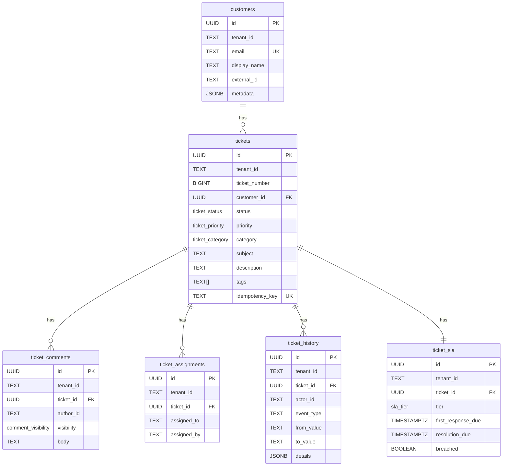
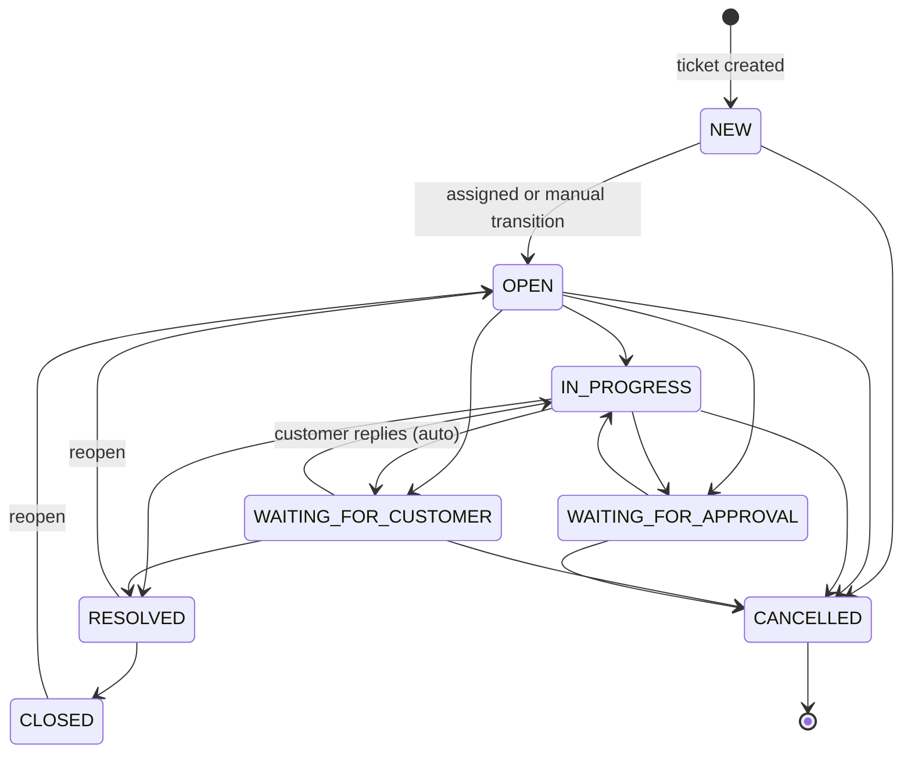
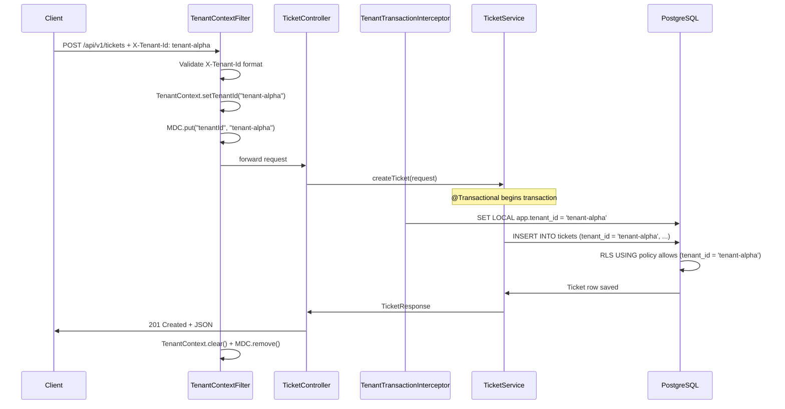

# Phase 3 Reverse-Engineering Guide — Core Ticketing Service

## 1. Overview

Phase 3 delivers the **Ticket Service** (`ticket-service`) — a Spring Boot 3 / Java 21 microservice that manages support tickets with multi-tenant isolation, state machine enforcement, and RFC 7807 error responses. It owns `ticket_db` exclusively and runs on port `8081`.

---

## 2. Database Schema

### Entity Relationship Diagram



### RLS Policy Pattern

Every tenant-scoped table uses the identical pattern:

```sql
ALTER TABLE <table> ENABLE ROW LEVEL SECURITY;
ALTER TABLE <table> FORCE ROW LEVEL SECURITY;

CREATE POLICY <table>_tenant_isolation ON <table>
    USING (tenant_id = current_setting('app.tenant_id', true))
    WITH CHECK (tenant_id = current_setting('app.tenant_id', true));
```

**Key invariant:** `FORCE ROW LEVEL SECURITY` is set so even the table owner (postgres superuser connecting as app_user) cannot bypass the policy. This ensures no code path can inadvertently return cross-tenant data.

---

## 3. Ticket State Machine



**Implementation:** [`TicketStateMachine.java`](../../../../backend/ticket-service/src/main/java/com/enterpriseai/ticket/domain/TicketStateMachine.java) holds a static `Map<TicketStatus, Set<TicketStatus>>` — the single source of truth. Calling `TicketStateMachine.transition(from, to)` throws `InvalidStateTransitionException` (HTTP 422) if the transition is invalid.

**Auto-transitions:**
- `NEW → OPEN`: triggered automatically on first agent assignment
- `WAITING_FOR_CUSTOMER → IN_PROGRESS`: triggered when a PUBLIC comment is added

---

## 4. Request Lifecycle



---

## 5. Key Classes

| Class | Package | Purpose |
|---|---|---|
| `TicketServiceApplication` | `ticket` | Spring Boot entry point |
| `TenantContextFilter` | `ticket.config` | Extracts X-Tenant-Id header → TenantContext |
| `TenantTransactionInterceptor` | `ticket.config` | AOP aspect → SET LOCAL app.tenant_id before every @Transactional |
| `TicketStateMachine` | `ticket.domain` | Validates state transitions; throws on invalid |
| `TicketService` | `ticket.service` | Business logic: create, transition, assign, comment |
| `TicketController` | `ticket.web` | REST API: CRUD + status + assignment + comments |
| `GlobalExceptionHandler` | `ticket.web` | RFC 7807 problem+json error mapping |
| `Ticket` | `ticket.entity` | JPA entity — maps to `tickets` table |
| `Customer` | `ticket.entity` | JPA entity — maps to `customers` table |
| `TicketHistory` | `ticket.entity` | Immutable audit trail — INSERT-only |
| `TicketSla` | `ticket.entity` | SLA tracking per ticket |

---

## 6. REST API Summary

| Method | Path | Description |
|---|---|---|
| `POST` | `/api/v1/tickets` | Create a ticket (supports Idempotency-Key) |
| `GET` | `/api/v1/tickets` | List tickets (paginated, tenant-scoped) |
| `GET` | `/api/v1/tickets/{id}` | Get ticket by ID |
| `PATCH` | `/api/v1/tickets/{id}/status` | Transition status (state machine validated) |
| `PUT` | `/api/v1/tickets/{id}/assignment` | Assign to agent/team |
| `POST` | `/api/v1/tickets/{id}/comments` | Add PUBLIC or INTERNAL comment |
| `GET` | `/api/v1/tickets/{id}/comments` | List comments |
| `DELETE` | `/api/v1/tickets/{id}` | Soft delete (sets deleted_at) |

Swagger UI: `http://localhost:8081/swagger-ui.html`

---

## 7. RLS Transaction Interceptor

The critical cross-cutting security concern is `TenantTransactionInterceptor`:

```java
@Around("@annotation(org.springframework.transaction.annotation.Transactional) && " +
        "within(com.enterpriseai.ticket.service..*)")
public Object setTenantRls(ProceedingJoinPoint joinPoint) throws Throwable {
    String tenantId = TenantContext.getTenantId();
    if (tenantId != null) {
        session.doWork(connection ->
            PostgresTenantRlsEnforcer.setTransactionTenant(connection, tenantId)
        );
    }
    return joinPoint.proceed();
}
```

`PostgresTenantRlsEnforcer` (in `backend/common`) executes:

```sql
SET LOCAL app.tenant_id = 'tenant-alpha';
```

`SET LOCAL` automatically reverts when the transaction commits or rolls back — no cleanup needed, no connection pool leakage.

---

## 8. Phase 3 Test Evidence

```
RLS_Alpha_Ticket_Count        : PASS  — tenant-alpha sees 1 ticket
RLS_Beta_Ticket_Count         : PASS  — tenant-beta sees 1 ticket
RLS_Cross_Tenant_Denial       : PASS  — alpha cannot read beta ticket by UUID
RLS_Default_Deny_Tickets      : PASS  — 0 rows without app.tenant_id
RLS_Customer_Alpha_Isolation  : PASS  — alpha sees only its own customers
Seed_Data_Integrity           : PASS  — idempotency_key seed confirmed
Schema_Status_Enum            : PASS  — all 8 TicketStatus values present in DB enum
Schema_RLS_All_Tables         : PASS  — 6/6 tables have RLS enabled
Schema_Ticket_Indexes         : PASS  — 10 indexes on tickets table
Permissions_App_User_Select   : PASS  — app_user can SELECT (RLS-scoped)
                                        10/10 PASSED
```

---

## 9. Memory Budget

After Phase 3 (schema + Spring Boot code authored; service not yet containerized in core profile):

| Component | Memory |
|---|---|
| `enterprise-ai-keycloak` | ~519 MiB |
| `enterprise-ai-postgres` | ~74 MiB |
| `enterprise-ai-redis` | ~8 MiB |
| `enterprise-ai-kafka` | ~382 MiB |
| `ticket-service` (when built) | ~256 MiB (Xmx cap) |
| **Total (projected)** | **~1240 MiB (~8% of 16 GB)** |

